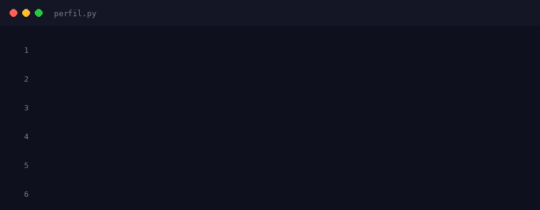

  

# BITÁCORA DE LA MATERIA

Bienvenido al diario de actividades del curso. Aquí documento lo realizado en cada sesión.

## Lista de Clases

| Clase | Fecha | Tema | Enlace |
| :--- | :--- | :--- | :--- |
| 01 | 2 de septiembre | Paradigmas de programación | [Ver clase](./clase-01/) |
| 02 | 7 de septiembre | NO ASISTÍ A CLASE | NA |
| 03 | 9 de septiembre | Funciones de orden superior | [Ver clase](./clase-03/) |
| 04 | 14 de septiembre | Funciones map y filter usando expresiones lambda | [Ver clase](./clase-04/) |
| 05 | 21 de septiembre | PROGRAMACIÓN FUNCIONAL | [Ver clase](./clase-05/) |
| 06 | 24 de septiembre | NO ASISTÍ | NA |
| 07 | 28 de septiembre| RECURSIVIDAD | [Ver clase](./clase-06/) |
